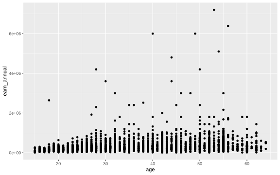

# ECO346 Assignment 1: Earnings and Age in Urban Sindh

**Registration number:** FA24-BEDS-003  
**Variant:** 3 (3 = 0 × 8 + 3), **Sindh urban** (`prov_code == 3`, `urban_rural == 2`)  
**Data:** PSLM 2019–20 person and household files  
**Sample:** earners, i.e. persons aged 15–64 with `earn_annual` > 0, weighted by `hhweight`

## Repository structure

```
README.md
data/       pslm_person_subset.csv, pslm_hh_subset.csv
scripts/    01_default.R, 02_distribution.R, 03_relationship.R, 04_second_language.py
figures/    default.svg, distribution.svg, relationship.svg, relationship_python.svg
slides/     FA24-BEDS-003.pptx
```

## How to reproduce

Clone the repository, open R (or a terminal) in the repository's top folder, and run the scripts in order. No internet connection is needed.

```
Rscript scripts/01_default.R
Rscript scripts/02_distribution.R
Rscript scripts/03_relationship.R
python scripts/04_second_language.py
```

R packages: `ggplot2`, `svglite`, `scales`. Python packages: `pandas`, `numpy`, `matplotlib`.

---

## Question 2: The distribution


| Statistic | Result |
|---|---:|
| Persons aged 15–64 in Sindh urban | 6,687 |
| Number of earners (`earn_annual` > 0) | 2,644 |
| Unweighted median | Rs 252,000 |
| Weighted median | Rs 264,000 |
| Weighted 10th percentile (P10) | Rs 120,000 |
| Weighted 90th percentile (P90) | Rs 696,000 |
| P90 / P10 ratio | 5.80 |
| Earners excluded from the histogram (outside Rs 10,000 to Rs 10,000,000) | 2 |

Both excluded earners fall below Rs 10,000; none is above Rs 10,000,000.

### Interpretation

Earnings are widely dispersed: the weighted 90th percentile (Rs 696,000) is 5.8 times the 10th (Rs 120,000), and the log scale shows a long upper tail. The weighted median (Rs 264,000) is Rs 12,000 above the unweighted median (Rs 252,000) because weighting lets households that represent more people count for more, and the weighted distribution sits slightly higher.

---

## Question 3: The relationship between age and earnings


### Band table

| Age band | Number of earners | Weighted mean earnings (Rs) |
|:---|---:|---:|
| 15–19 | 160 | 192,523 |
| 20–24 | 296 | 222,948 |
| 25–29 | 398 | 303,154 |
| 30–34 | 396 | 379,254 |
| 35–39 | 359 | 360,221 |
| 40–44 | 344 | 446,533 |
| 45–49 | 250 | 431,697 |
| 50–54 | 212 | 530,773 |
| 55–59 | 157 | 542,400 |
| 60–64 | 72 | 414,262 |

No band has fewer than 30 earners, so no marker is hollow.

### Required results

- Weighted mean earnings, ages 25–29: **Rs 303,154**
- Weighted mean earnings, ages 45–49: **Rs 431,697**
- Band with the highest weighted mean: **55–59** (Rs 542,400)

### Interpretation

Weighted mean earnings rise from Rs 192,523 at ages 15–19 to a peak of Rs 542,400 at ages 55–59, then fall to Rs 414,262 at 60–64. The climb is uneven, with dips at 35–39 and 45–49. An economist would read this as consistent with returns to experience, plus retirement or selection among older workers. Individual earnings vary widely within every band. The figure cannot tell us whether any person's earnings rise as they age, because it compares different people at one point in time.

---

## Question 4: The makeover

| Default (R's defaults) | Redesign (Question 3 figure) |
|---|---|
|  |  |

The default is `ggplot(data, aes(age, earn_annual)) + geom_point()`, saved as `figures/default.svg` and committed before the redesign.

### Explanation of the redesign

Three changes stand out. First, a log vertical axis, labelled in rupees: earnings span several orders of magnitude, so on a linear scale most points are squashed near the bottom. Second, transparency and horizontal jitter: ages are whole numbers, so points stack in columns, and these changes counter overplotting and show density. Third, weighted band means joined by a line: these are conditional means, and they show the age pattern the cloud hides. Position along a common scale is the most accurately read channel. A quieter theme and direct annotation also raise the data–ink share. The default shows the two earners below Rs 10,000; the redesign clips them.

---

## Question 5: A second language (Python)

The band table of Question 3 was recomputed in Python (`scripts/04_second_language.py`) and the figure redrawn as `figures/relationship_python.svg`. The two band tables agree to the rupee.


| | Weighted mean, ages 25–29 |
|---|---:|
| R | Rs 303,154 |
| Python | Rs 303,154 |

### Note on a default that differed

Matplotlib's log axis labels powers of ten (10⁴, 10⁵, …), whereas R's `label_comma()` prints full rupee values. I set a comma `FuncFormatter`, and also fixed `set_xlim`, `set_ylim` and `set_xticks` so the axis limits and breaks match R.
